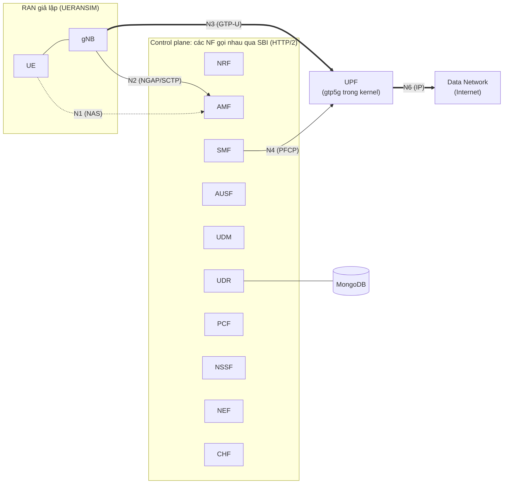

# 5GC-Core: free5GC trên Ubuntu kernel 7.0

Chạy một 5G Core kiểu Standalone (SA) bằng [free5GC](https://free5gc.org/) và
[free5gc-compose](https://github.com/free5gc/free5gc-compose) trên Ubuntu dùng **kernel Linux 7.0**.
Mỗi Network Function (NF) chạy trong một container Docker riêng.

Mặc định, module **gtp5g** mà UPF cần không build được trên kernel 7.0. Repo này cung cấp bản vá và script để
build gtp5g đúng phiên bản, giúp UPF chạy được.

---

## Kiến trúc



- **Control plane** gồm mọi NF trừ UPF. Khi khởi động, mỗi NF đăng ký với **NRF**; sau đó các NF tìm nhau qua NRF
  và gọi nhau bằng HTTP/2 trên mạng `10.100.200.0/24`. Bản compose này không bật SCP, nên các NF gọi trực tiếp lẫn nhau.
- **User plane** chỉ có **UPF**. SMF cài luật xử lý gói (PDR, FAR, QER, URR, BAR) xuống UPF qua N4. Việc đóng và mở gói
  GTP-U được làm trong kernel bằng module **gtp5g**, vì vậy chỉ UPF cần module này.
- Dữ liệu người dùng đi theo đường `UE → gNB → N3 → UPF → N6 → Internet`, không đi qua NF control plane nào.

## Các container

| Container | NF | Plane | Vai trò |
| --- | --- | --- | --- |
| `nrf` | Network Repository Function | CP | Danh bạ: NF đăng ký và tìm nhau |
| `amf` | Access and Mobility Management Function | CP | Đăng ký, di động, đầu cuối N1/N2 |
| `smf` | Session Management Function | CP | Quản lý PDU session, cấp IP, điều khiển UPF qua N4 |
| `upf` | User Plane Function | UP | Chuyển gói, áp QoS, đếm lưu lượng |
| `ausf` | Authentication Server Function | CP | Xác thực 5G-AKA |
| `udm` | Unified Data Management | CP | Quản lý dữ liệu thuê bao |
| `udr` | Unified Data Repository | CP | Kho dữ liệu, lưu trong MongoDB |
| `pcf` | Policy Control Function | CP | Chính sách và QoS |
| `nssf` | Network Slice Selection Function | CP | Chọn network slice |
| `nef` | Network Exposure Function | CP | Mở API cho ứng dụng bên ngoài |
| `chf` | Charging Function | CP | Tính cước |
| `n3iwf`, `tngf` | Cổng truy nhập non-3GPP | — | Truy nhập qua Wi-Fi/mạng ngoài 3GPP; không cần cho kịch bản cơ bản |
| `webui` | Web console | — | Quản lý thuê bao tại `http://localhost:5000` |
| `mongodb` | Cơ sở dữ liệu | — | Nơi UDR lưu dữ liệu |
| `ueransim`, `n3iwue` | gNB/UE giả lập | — | Dùng để thử đăng ký và mở phiên dữ liệu |

## Cấu hình mặc định

Các giá trị dưới đây lấy theo free5gc-compose commit `b4e52c4`:

| Tham số | Giá trị |
| --- | --- |
| Image free5GC | `v4.3.0` |
| PLMN (MCC/MNC) | `208` / `93` |
| TAC | `000001` |
| S-NSSAI | SST `1` / SD `010203`, SST `1` / SD `112233` |
| DNN và dải IP cấp cho UE | `internet`: `10.60.0.0/16`, `10.61.0.0/16` |
| Mạng SBI | `10.100.200.0/24` (NRF lắng nghe cổng `8000`) |
| N2 / N3 / N4 | SCTP `38412` / UDP `2152` / UDP `8805` |
| Thuê bao mẫu | `imsi-208930000000001` (K và OPc lấy trong `config/uecfg.yaml` của free5gc-compose) |

## Vấn đề gtp5g trên kernel 7.0

gtp5g là module kernel, nên phải build khớp với kernel đang chạy. Ngoài ra, phiên bản của nó còn phải nằm trong
khoảng UPF chấp nhận: UPF `v4.3.0` yêu cầu `0.9.3 <= version < 0.10.3`.

| Phiên bản thử | Kết quả | Nguyên nhân |
| --- | --- | --- |
| `v0.9.5` | Không build được | API của kernel 7.0 đã đổi: lỗi `genl.h`, `setup_udp_tunnel_sock`, `udp_tunnel_xmit_skb` |
| master (`0.10.3`) | Build được, nhưng UPF thoát ngay | `version mismatch: should be 0.9.3 <= version < 0.10.3` |
| `v0.10.2` | Không build được | Thiếu bản sửa cho kernel 6.18 trở lên: `flowi4_tos` đã đổi thành `flowi4_dscp` |
| **`v0.10.2` + bản vá** | **Build được, UPF chạy, PFCP association với SMF thành công** | — |

Bản vá [`patches/gtp5g-kernel7.patch`](patches/gtp5g-kernel7.patch) áp lên tag `v0.10.2` (commit `952fb41`) và gồm hai phần:

1. Commit upstream [`a2a19e2`](https://github.com/free5gc/gtp5g/commit/a2a19e29334ffc4872b916822fb2bd78f3791e5a)
   *"fix: build on Linux kernel 6.18 and 7.0"*: dùng `flowi4_dscp` thay `flowi4_tos`, và sửa kiểu tham số `connect` cho kernel 7.0.
2. Sửa một dòng trong `src/gtpu/encap.c`: tham số thứ hai của `setup_udp_tunnel_sock` đổi từ `sock` (`struct socket *`)
   thành `sock->sk` (`struct sock *`), theo yêu cầu của kernel `7.0.0-43-generic`.

Mỗi lần kernel được cập nhật, module sẽ không còn nạp được nữa. Khi đó chạy lại `scripts/install-gtp5g.sh` để build lại.

## Cài đặt

Đã thử trên: máy ảo VMware, Ubuntu với kernel `7.0.0-43-generic`, 2 vCPU, 5 GB RAM, 50 GB ổ đĩa.
Cần tắt Secure Boot, vì Secure Boot chặn module kernel tự build.

```bash
# 1. Gói cần thiết
sudo apt update
sudo apt -y install git make gcc g++ cmake autoconf libtool pkg-config \
  libmnl-dev libyaml-dev linux-headers-$(uname -r)

# 2. Docker Engine + Docker Compose v2
curl -fsSL https://get.docker.com -o get-docker.sh && sudo sh get-docker.sh
sudo usermod -aG docker $USER        # đăng xuất rồi đăng nhập lại

# 3. Build và cài gtp5g
git clone https://github.com/hsk2notme/5GC-Core.git ~/5gc-lab
bash ~/5gc-lab/scripts/install-gtp5g.sh

# 4. Chạy free5GC
git clone https://github.com/free5gc/free5gc-compose.git ~/free5gc-compose
cd ~/free5gc-compose
git checkout b4e52c42406c1335a9a9b7d1b733dd134b82b86a
docker compose pull
docker compose up -d

# 5. Kiểm tra
bash ~/5gc-lab/scripts/check-nf.sh
docker logs upf 2>&1 | grep -E "UPF started|AssociationSetup"
```

Nếu mọi thứ ổn, mọi container (trừ `tngf`) đều ở trạng thái `Up`. Log NRF có các dòng `NFRegisterRequest`.
Log UPF có `UPF started` và `handleAssociationSetupRequest` từ `smf.free5gc.org`.

**Thêm thuê bao:** mở `http://localhost:5000`, đăng nhập `admin` / `free5gc`, chọn **SUBSCRIBERS → CREATE**,
giữ nguyên các giá trị mặc định rồi bấm **CREATE**.

**Tạm dừng và bật lại:** `docker compose stop` / `docker compose start`.

## Cấu trúc repo

```
.
├── evidence/                     # kết quả kiểm tra trên máy đã chạy
│   ├── docker-ps.txt             # trạng thái các container
│   ├── nrf-register.log          # các NF đăng ký với NRF
│   ├── upf.log                   # UPF khởi động, PFCP association với SMF
│   ├── gtp5g-version.txt
│   ├── lsmod-gtp.txt
│   ├── kernel.txt
│   └── free5gc-compose-commit.txt
├── patches/
│   ├── gtp5g-base-commit.txt     # tag v0.10.2
│   └── gtp5g-kernel7.patch
└── scripts/
    ├── install-gtp5g.sh          # build và cài gtp5g từ commit gốc + bản vá
    └── check-nf.sh               # xem trạng thái NF và log đăng ký NRF
```

## Tài liệu tham khảo

- 3GPP TS 23.501: System architecture for the 5G System
- 3GPP TS 23.502: Procedures for the 5G System
- 3GPP TS 29.244: PFCP (giao diện N4)
- [free5GC](https://free5gc.org/) · [free5gc-compose](https://github.com/free5gc/free5gc-compose) · [gtp5g](https://github.com/free5gc/gtp5g)

## Giấy phép

Repo này không chứa mã nguồn free5GC. Bản vá trong `patches/` sửa mã của [gtp5g](https://github.com/free5gc/gtp5g),
vốn dùng giấy phép GPL-2.0, nên bản vá cũng theo GPL-2.0.
